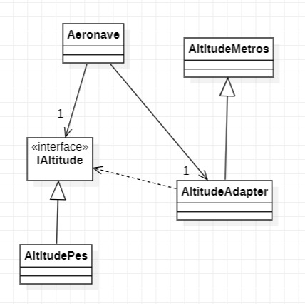

# Exercício Adapter, Adaptador de Pés para Metros
#### Nome: João Vitor Fernandes Ribeiro Carneiro Ramos
#### Matrícula: 202165076C

Implementação do padrão de projeto **Adapter** em Java.

## Diagrama UML

